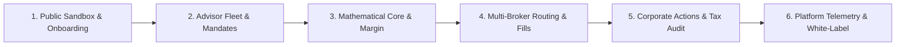

# Solution Demo Narrative & Walkthrough Blueprint

This document defines the canonical demonstration narrative for the **Accordant Rebalancing Platform**. It is structured for maximum impact when presenting to institutional partners, prospective wealth management tenants, investment committees, or engineering evaluators.

It is designed to be executable either as a human-led presentation or as an autonomous **AI Agent Skill** (`skills/solution-demo/SKILL.md`) that spins up the engine locally, seeds reproducible fixtures, and walks the audience through every core and supporting capability.

---

## 1. Narrative Architecture & Philosophy

### Core Narrative Principle: "From Commercial Hook to Institutional Depth"
Many financial platforms demonstrate features in an arbitrary order. This narrative follows a deliberate **progressive disclosure arc**:
1. **The Commercial Hook (Instant Value)**: Start with unauthenticated capabilities—the public interactive sandbox and self-serve onboarding—proving zero friction to value.
2. **The Front-Office Experience (Operational Elegance)**: Move into the advisor dashboard, showing how complex portfolio drift is reduced to actionable, 1-click decisions with model mandates.
3. **The Engine Core (Financial & Mathematical Rigor)**: Dive beneath the hood to demonstrate deterministic execution, friction/TCO optimization, and strict margin/leverage invariants.
4. **The Custodial Fabric (Pluggable Execution)**: Show real-world execution routing across multiple brokers (Alpaca, IBKR, Mock) with live streaming WebSocket fills and out-of-order shadow ledger reconciliation.
5. **The Institutional Back-Office (Governance & Compliance)**: Reveal corporate action basis adjustments, UK/US tax overlays, and cryptographically verifiable audit trails.
6. **The SaaS Control Plane (White-Label Scale)**: Conclude with superadmin telemetry, tenant partition management, and dynamic CSS white-labeling.



---

## 2. Process Taxonomy: Main vs. Supporting

To keep the walkthrough focused and prevent cognitive overload, capabilities are categorized into **Main Processes** (primary commercial and portfolio management value stream) and **Supporting Processes** (institutional governance, execution mechanics, and compliance foundations).

| Category | Process | Business Impact | Walkthrough Role |
| :--- | :--- | :--- | :--- |
| **Main** | **Zero-Touch Onboarding** | Eliminates weeks of enterprise IT provisioning. Creates isolated tenant partition & M2M keys in seconds. | **Scene 1**: The Opening Hook |
| **Main** | **Interactive Sandbox Simulator** | Lets prospects run real mathematical simulations on custom portfolios before signing. | **Scene 1**: Immediate Value |
| **Main** | **Advisor Fleet Drift & Heatmaps** | Visualizes asset drift across hundreds of accounts; detects threshold breaches in real time. | **Scene 2**: Daily Workflow |
| **Main** | **Model Mandate Fan-Out** | Propagates updated target weights across discretionary accounts with 1-click execution. | **Scene 2**: Operational Leverage |
| **Main** | **Deterministic Trade Generation** | High-precision `decimal.js` trade sizing guaranteeing full cash conservation and minimum trade suppression. | **Scene 3**: Mathematical Integrity |
| **Main** | **Multi-Custodian Order Routing** | Pluggable broker factory dynamically dispatching orders to Alpaca, Interactive Brokers, or Mock Engine. | **Scene 4**: Custodial Neutrality |
| **Supporting** | **Direct Margin & Leverage Cushions** | Reg-T compliant margin borrowing with automated insolvency ($NAV \le 0$) and maintenance margin protection. | **Scene 3**: Institutional Primitives |
| **Supporting** | **WebSocket Streaming Fills** | Idempotent shadow ledger updates resilient against out-of-order and partial execution fills. | **Scene 4**: Execution Resiliency |
| **Supporting** | **Corporate Actions Engine** | Automated stock split lot multiplication and dividend cash allocation with cost-basis preservation. | **Scene 5**: Lifecycle Accounting |
| **Supporting** | **Tax Overlays (US TLH & UK B&B)** | Jurisdiction-specific wash sale lockouts and Section 104 average cost pooling. | **Scene 5**: Fiduciary Compliance |
| **Supporting** | **Immutable Audit Trails** | Nonce-hashed JSONL and SQLite event ledgers proving end-to-end mathematical reproducibility. | **Scene 5**: Regulatory Assurance |
| **Supporting** | **Dynamic White-Label Theming** | Per-tenant CSS variable injection (`--tenant-primary`) and firm logo/portal title custom branding. | **Scene 6**: Enterprise Branding |

---

## 3. Demo Fixtures & Seed Scenarios

To ensure the demo is 100% reproducible and instant to reset, the walkthrough relies on pre-defined fixtures loaded into the database:

### Fixture 1: The "Apex Wealth" Multi-Asset Fleet (`fixtures/demo-fleet.json`)
- **Tenant ID**: `tenant-apex`
- **Branding**: Brand Name: *Apex Wealth Management*, Primary Color: `#0f766e` (Deep Emerald), Accent: `#0d9488`.
- **Portfolios**:
  1. `apex-growth-01` ($250,000 Equity): Subscribed to *Global Balanced Growth* (60% Equities, 40% Fixed Income). Drifted by **+8.4%** in US Tech (AAPL/MSFT) and **-8.4%** in US Bonds due to market run-up. **Triggers threshold rebalance.**
  2. `apex-margin-02` ($500,000 Equity / $150,000 Margin Borrowing): Leveraged mandate (130% target allocation). Demonstrates maintenance margin buffer health and negative cash support.
  3. `apex-bespoke-03` ($120,000 Equity): Bespoke portfolio with exclusion overlay on tobacco and defense assets.

### Fixture 2: Market Snapshot & Live Price Ticks (`fixtures/demo-prices.json`)
- Baseline prices across US Equities (`AAPL` = $180, `MSFT` = $420, `SPY` = $510, `BND` = $72).
- Dynamic price shock feed demonstrating threshold breach detection.

### Fixture 3: Corporate Action Event (`fixtures/demo-corporate-action.json`)
- A **2-for-1 stock split** on `AAPL` with an ex-date of today, plus a **$0.82 cash dividend** on `MSFT`, demonstrating automatic lot doubling, basis halving, and cash ledger credit.

---

## 4. The 6-Scene Walkthrough Script

### Scene 1: The Commercial Hook – Instant Sandbox & Zero-Touch Onboarding
- **Objective**: Show how easy it is for an institutional prospect to test and adopt the engine without IT friction.
- **Narrative Flow**:
  1. Navigate to the unauthenticated platform entrance (`http://localhost:5173`).
  2. Highlight the clean, modern login interface. Click **"Live Sandbox"**.
  3. In the sandbox modal, demonstrate that anyone can input a custom portfolio ($100k cash, AAPL, MSFT), set a 5% drift tolerance and 5 bps slippage, and click **"Run Rebalance Simulation"**.
  4. Point out the deterministic outputs: Initial Equity, Drift Reduction (e.g. 15.2% &rarr; 0.1%), Turnover %, and Estimated Friction Cost ($35.40).
  5. Close the sandbox and click **"Partner Sign-Up"**.
  6. Fill in: Firm Name: `Apex Wealth Management`, Slug: `apex-wealth`, Admin Email: `admin@apexwealth.com`, select **Interactive Brokers (IBKR)** as custodian, pick an Emerald brand color, and click **"Provision Tenant Workspace"**.
  7. Instantly display the provisioned M2M Production API Key (`sk_live_apex_...`) and click **"Sign In to Your Workspace"**. The email is pre-populated in the login field.

### Scene 2: The Advisory Desk – Fleet Heatmaps & Discretionary Mandates
- **Objective**: Demonstrate the portfolio manager's daily workflow—monitoring hundreds of accounts with progressive disclosure.
- **Narrative Flow**:
  1. Sign in as `advisor@tenant.com` (`changeme123`).
  2. Notice the **Advisor Workspace**:
     - Modern glassmorphic sidebar tailored specifically to portfolio managers.
     - Note that superadmin tabs (System Ops, Tenant Management) are strictly hidden per Rule 12.
  3. Open **All Portfolios (Fleet View)**:
     - Show the visual Drift Heatmap. Account `acc-2` has a red breach indicator (**+8.4% drift** in US Tech).
  4. Drill into `acc-2`:
     - Show the Mandate Configuration panel.
     - Switch subscription from *Bespoke* to *Discretionary (Model Mandate)*.
     - Select the *Global Balanced 60/40 Growth* model.
  5. Click **"Run Rebalance Evaluation"**:
     - The engine immediately calculates the required sell-side and buy-side trades, suppresses sub-minimum lots, and presents the trade proposal before execution.

### Scene 3: The Engine Room – Pure Math Core & Margin/Leverage Guardrails
- **Objective**: Prove financial accuracy, decimal precision, and institutional safety limits.
- **Narrative Flow**:
  1. Open a terminal side-by-side with the UI.
  2. Run the deterministic scenario runner:
     ```bash
     npm run scenario:run
     ```
  3. Highlight that all batch scenarios pass with exact mathematical reconciliation across `decimal.js` floating-point guardrails.
  4. Showcase **Direct Margin Borrowing (Slice 5 / ADR-0072)**:
     - Show a portfolio with `allowLeverage: true` and 130% target allocation.
     - Demonstrate that negative cash is permitted within Reg-T initial margin limits.
     - Simulate an extreme market drop: show how the engine rejects any trade proposal that would breach the **Maintenance Margin Requirement (MMR = 25%)** or cause insolvency ($NAV \le 0$), emitting `MARGIN_BUFFER_BREACH` warnings.

### Scene 4: Multi-Custodian Execution & Streaming Fills
- **Objective**: Prove broker neutrality and resilient asynchronous fill processing.
- **Narrative Flow**:
  1. Switch to the **Broker Integrations** configuration.
  2. Explain the pluggable **Broker Factory (ADR-0071)**:
     - Show how the same mandate executes identically across **Alpaca** (US retail equity API) and **Interactive Brokers Client Portal Gateway** (institutional multi-asset via `conId` translation).
  3. Trigger a mock rebalance execution.
  4. Point to the real-time event ticker in the Command Center:
     - Show WebSocket trade update events streaming in: `NEW` &rarr; `PARTIAL_FILL` &rarr; `FILLED`.
     - Point out the **Cumulative Fill Reconciliation (ADR-0070)**: Even if partial fills arrive out of order, the shadow ledger uses stored timestamps and cumulative quantities to guarantee exact cash and share balances without duplicate deductions.

### Scene 5: Institutional Governance – Corporate Actions & Immutable Audit
- **Objective**: Address the hardest questions from compliance officers and risk auditors.
- **Narrative Flow**:
  1. Sign out and log in as `compliance@tenant.com` (`changeme123`).
  2. Observe the **Compliance & Audit Explorer**:
     - Layout updates to rose/amber compliance accents; trading actions are locked out.
  3. Demonstrate **Tax-Loss Harvesting & Wash Sale Lockouts (ADR-0059 / ADR-0062)**:
     - Show that selling `SPY` at a loss automatically applies a 30-day lockout flag on buy orders, preventing disallowed IRS/HMRC loss claims.
  4. Inspect the **Corporate Actions Engine (ADR-0060)**:
     - Review the log for the 2-for-1 `AAPL` stock split: show that the historical cost basis was halved while lot quantities doubled, preserving original acquisition dates for long-term capital gains qualification.
  5. Expand an Audit Record:
     - Show the complete JSON payload containing raw price snapshot, drift analysis, trigger conditions, generated orders, and SHA-256 event hash.

### Scene 6: The SaaS Control Plane – Telemetry, Tenants & White-Label Pulse
- **Objective**: Close with platform-level scalability, tenant isolation, and custom branding.
- **Narrative Flow**:
  1. Sign out and log in as `admin@localhost` (`changeme123`).
  2. Enter the **Superadmin System Pulse**:
     - Show the cross-tenant health telemetry: active WebSocket connections, SQLite state size, scheduler queue latency, and circuit breaker status.
  3. Open **Tenant Management**:
     - Review the tenant directory. Point out the newly created `Apex Wealth Management` tenant from Scene 1.
     - Edit Apex Wealth's white-label theme: update the primary color to `#0f766e` and upload a custom firm logo.
  4. Log in under Apex Wealth's admin account:
     - Demonstrate that the entire application header, buttons, and accents have dynamically adapted to the firm's brand identity via `--tenant-primary`.

---

## 5. Automated Skill Specification (`skills/solution-demo/SKILL.md`)

This narrative can be packaged directly as an Antigravity customization skill. Below is the specification for the skill implementation:

### Skill Structure
```
skills/solution-demo/
├── SKILL.md                          # Main skill prompt and step-by-step agent instructions
├── scripts/
│   ├── seed-demo-fixtures.ts         # Seeds tenant-apex, drifted portfolios, and models
│   ├── reset-demo-db.ts              # Restores SQLite database to pristine demo baseline
│   └── simulate-broker-fills.ts      # Injects mock WebSocket execution fills
└── references/
    └── scene-talking-points.md       # Concise speaker notes for each scene
```

### `SKILL.md` Instruction Template
```yaml
---
name: solution-demo
description: Runs an automated, end-to-end interactive demonstration of the Accordant Rebalancing Platform. Resets demo data, launches local servers, and walks through sandbox, advisor, margin, multi-broker, and compliance workflows.
---

# Solution Demo Runner

When invoked, execute the following workflow:

1. **Environment Reset & Fixture Seeding**:
   - Run `npx tsx skills/solution-demo/scripts/reset-demo-db.ts` to ensure clean SQLite state.
   - Run `npx tsx skills/solution-demo/scripts/seed-demo-fixtures.ts` to populate the `tenant-apex` scenario.
2. **Launch Application Services**:
   - Ensure the Express backend (`npm run dev`) and Vite frontend (`npm run --prefix web dev`) are running on ports 3000 and 5173.
3. **Interactive Walkthrough Execution**:
   - Utilize the browser subagent to execute Scenes 1 through 6 in sequence.
   - Capture clean screenshots of the interactive sandbox, fleet heatmap, margin buffer calculation, and audit explorer.
   - Present a structured summary of each scene with corresponding URLs and verification metrics.
```

---

## 6. Summary Checklist for Presenters

| Step | Action | Expected Milestone |
| :---: | :--- | :--- |
| **1** | Open `http://localhost:5173` | Unauthenticated portal loads with "Live Sandbox" and "Partner Sign-Up". |
| **2** | Run Sandbox Simulation | Deterministic KPIs: Initial Value, Drift %, Turnover %, Friction $. |
| **3** | Sign in as Advisor | Heatmap displays drift breaches; 1-click model mandate proposal generation. |
| **4** | Run Math & Margin Validation | CLI confirms 100% test pass; margin buffers prevent insolvency. |
| **5** | Inspect Custodian Routing | Multi-custodian factory dispatches to Alpaca & IBKR; WebSocket fills update shadow ledger. |
| **6** | Audit & White-Label Theming | Compliance inspects corporate actions & tax overlays; superadmin confirms white-label CSS branding. |

&copy; 2026 Johan Hellman. All rights reserved.
