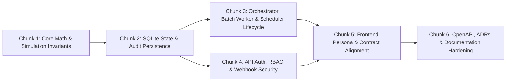

# Holistic Codebase Review Remediation Plan

**Source Audit:** [Holistic Codebase & Architecture Review (2026-10-16)](../audits/holistic-codebase-review-2026-10-16.md)  
**Associated Decision Record:** [ADR-0067: Holistic Audit Remediation & Domain Invariants](../decisions/0067-holistic-audit-remediation-and-domain-invariants.md)

---

## 1. Organizing Strategy: Dependency-Ordered, Domain-Bounded Slices

We evaluated three candidate grouping models for remediating the ~25 audit findings:
1. **Purely by Criticality (`CRITICAL` $\rightarrow$ `HIGH` $\rightarrow$ `MEDIUM`):** Rejected because a single P0 commit would span core math, SQLite queries, cron scheduling, and Express auth, creating a high-blast-radius diff that is difficult to review or bisect.
2. **Purely by Directory (`src/core` $\rightarrow$ `src/orchestrator` $\rightarrow$ `src/api` $\rightarrow$ `web/`):** Rejected because vertical feature lifecycles (such as `MandateSchedulerService` $\rightarrow$ `CalendarRebalanceStrategy` $\rightarrow$ `/api/admin/scheduler/*`) cross directory boundaries and must be fixed and tested as a unit.
3. **Purely by Theme ("Security", "Math", "ADR Alignment"):** Rejected because "ADR Alignment" is achieved by fixing the underlying code paths rather than as a separate pass over the same files.

### Chosen Hybrid Model
We organize the work into **6 self-contained, dependency-ordered chunks** combining:
- **Bottom-Up Architectural Layering:** Pure domain math (`Chunk 1`) $\rightarrow$ SQLite state & audit persistence (`Chunk 2`) $\rightarrow$ Orchestrator, batch worker & scheduler lifecycles (`Chunk 3`) $\rightarrow$ API auth, RBAC & webhook security (`Chunk 4`) $\rightarrow$ Frontend persona & API contracts (`Chunk 5`) $\rightarrow$ OpenAPI, ADR registry & documentation lock-in (`Chunk 6`).
- **Vertical Lifecycle Cohesion:** Tightly coupled producer-consumer pairs are fixed and tested together.
- **Explicit Checkpoints:** Each chunk has its own unit/integration test additions, full test-suite verification, and dedicated conventional commit.

---

## 2. Open Design Question Resolutions (Recorded in ADR-0067)

### Decision A: Corporate Action Cash Dividend Accounting (`applyCorporateActionToPortfolio` vs. `calculateValuation`)
- **Problem:** `applyCorporateActionToPortfolio` increments `portfolio.cash` by `dividendTotal` **and** appends a `CashFlow` record (`cashFlowId: 'div-...'`, `direction: 'DEPOSIT'`, `status: 'SETTLED'`). When `calculateValuation` subsequently calls `summarizeCashFlows(state.cash, state.cashFlows)`, it adds all `SETTLED` deposits to `state.cash`, double-counting the dividend in in-memory evaluations while SQLite reloads only `PENDING` cash flows.
- **Options Considered:**
  1. *Stop incrementing `portfolio.cash` in `applyCorporateActionToPortfolio`*: Breaks existing expectations on `updatedPortfolio.cash`, `CorporateActionResult.cashAdjustment`, and `SqliteStateManager.applyCorporateAction` (which persists `portfolio.cash` to `Portfolios.cash` and only reloads `PENDING` cash flows).
  2. *Stop appending a `CashFlow` record in `applyCorporateActionToPortfolio`*: Loses the structured dividend cash-flow audit trail on `PortfolioState.cashFlows`.
  3. **Preferred — Recognize corporate-action dividend cash flows (`div-*`) in `summarizeCashFlows` as already reflected in `state.cash`**: Adjust `startingCash` in `summarizeCashFlows` by subtracting settled corporate-action dividends already credited to `state.cash` so `startingCash + netSettledCashFlow === state.cash` (+ any external uncredited settled deposits).
- **Rationale:** Preserves 100% compatibility with `CorporateActionResult.cashAdjustment`, keeps the structured `div-*` cash flow record for auditability, and guarantees identical `availableCash` and `totalPortfolioValue` between in-memory evaluation and SQLite-reloaded state.

### Decision B: `depositAllocationMode` (`'REBALANCING' | 'CURRENT_WEIGHT' | 'FIXED_TARGET'`)
- **Problem:** `depositAllocationMode` is defined on `RebalancingPolicy`, exposed in `MandateBuilderForm.tsx`, and documented in `openapi.ts`, but is not implemented in `src/core/trades.ts`.
- **Options Considered:**
  1. *Remove `depositAllocationMode` from domain models, UI, and OpenAPI*: Introduces breaking schema and UI changes.
  2. **Preferred — Implement `depositAllocationMode` deterministically in `src/core/trades.ts`**:
     - `'REBALANCING'` (default): Existing behavior—full portfolio valuation (including cash/deposits) is rebalanced toward target weights or tolerance boundaries.
     - `'FIXED_TARGET'`: When investable cash above target `cashBuffer` is positive, deploy only that excess cash across instruments strictly proportional to normalized `target.targets` weights (`BUY`-only, preserving existing holdings).
     - `'CURRENT_WEIGHT'`: When investable cash above target `cashBuffer` is positive, deploy only that excess cash across held instruments strictly proportional to current holding weights (`BUY`-only, falling back to target weights if current holdings value is zero).
- **Rationale:** Fulfils the existing domain/UI/OpenAPI contract in ~25 lines of pure `decimal.js` logic without breaking API consumers.

### Decision C: Calendar Mandate Scheduler Handoff (`MandateSchedulerService` $\rightarrow$ `CalendarRebalanceStrategy`)
- **Problem:** `MandateSchedulerService.scanAndEnqueue` immediately advances `policy.calendar.nextRebalanceDate` in SQLite when enqueuing a due portfolio, causing `CalendarRebalanceStrategy.evaluateTrigger` to see a future `nextRebalanceDate` and return `CALENDAR_NOT_DUE` (`shouldRebalance: false`) when the worker processes the queue.
- **Decision:** Record `lastTriggeredRebalanceDate: evalDateStr` on `policy.calendar` when `scanAndEnqueue` advances `nextRebalanceDate`, and update `CalendarRebalanceStrategy.evaluateTrigger` to trigger when `evalDate >= nextRebalanceDate || (lastTriggeredRebalanceDate !== undefined && evalDate >= lastTriggeredRebalanceDate)`. This preserves idempotent date advancement in the scheduler while ensuring downstream queue workers evaluate the due calendar rebalance as triggered.

---

## 3. Detailed Implementation Chunks

### Chunk 1: Core Financial Math, Overlays & Simulation Integrity
- [x] Reconcile corporate action cash dividend valuation in `src/core/valuation.ts`.
- [x] Fix `SPLIT` and `MERGER` tax-lot quantity rounding residuals and deduplicate merged `lotId`s in `src/core/corporate-actions.ts`.
- [x] Preserve `taxLots` and all `PortfolioState` metadata fields in `simulatePostTrade` (`src/core/simulation.ts`) and remove debug `console.log`.
- [x] Implement `depositAllocationMode` (`'FIXED_TARGET'` and `'CURRENT_WEIGHT'`) in `src/core/trades.ts`.
- [x] Wire `input.indicators` and `input.frictionModel` into `evaluateRebalanceAsync` (`src/core/evaluation.ts`) and `StandardRuleBasedTradeGenerator` (`src/strategy/optimizers/standard-optimizer.ts`).
- [x] Replace remaining native floating-point arithmetic with `decimal.js` in `src/core/overlays.ts`, `src/core/oracle-adapter.ts`, `src/core/drift.ts`, `src/core/trades.ts`, `src/core/quality.ts`, and `src/core/friction.ts`; deduplicate `'WASH_SALE_LOCKOUT'` in `src/models/domain.ts`.
- [x] Add comprehensive unit tests in `tests/` and verify all core suites + `npm run scenario:run`.

### Chunk 2: SQLite State & Audit Persistence Integrity
- [x] Include `p.cashBuffer` and pending `CashFlows` in `SqliteStateManager.getStatesFilteredByTenant` (`src/orchestrator/sqlite-state.ts`).
- [x] Include `submittedBy` (defaulting to `'system'`) when inserting `CashFlows` in `SqliteStateManager.updatePortfolio` (`src/orchestrator/sqlite-state.ts`).
- [x] Persist `policy`, `taxJurisdiction`, and `taxWrapper` updates to SQLite in `PUT /api/portfolios/:id/policy` (`src/api/routes/portfolios.ts`, `src/orchestrator/sqlite-state.ts`, `src/orchestrator/state.ts`).
- [x] Persist `universe` column on `Models` (`src/db/sqlite.ts`, `src/db/repositories/ModelRepository.ts`, `src/orchestrator/sqlite-state.ts`) and allow `MinimumVariance` and `EfficientFrontier` archetypes in `validateModelMandate` (`src/api/server.ts`).
- [x] Populate `AuditRecord.type` (`LIVE_EXECUTION` / `DRY_RUN_EVALUATION`) in `SqliteAuditStorage` / callers so `/execution-status` and `/audit-trail` queries succeed.
- [x] Add read-after-write persistence tests in `tests/sqlite-state.test.ts` and `tests/api.test.ts`.

### Chunk 3: Orchestrator, Batch Worker & Mandate Scheduler Lifecycle
- [x] Fix calendar trigger handoff between `MandateSchedulerService.scanAndEnqueue` (`src/orchestrator/scheduler.ts`) and `CalendarRebalanceStrategy` (`src/strategy/calendar.ts`).
- [x] Wire a shared `MandateSchedulerService` instance in `src/api/server.ts` and `src/cli/agent.ts`.
- [x] Enforce `circuitBreakerStatus === 'open'` and `brokerAdapter.hasOpenOrders(...)` checks in `Orchestrator.onTick` (`src/orchestrator/loop.ts`) and `BatchEvaluationWorker.processNextBatch` (`src/orchestrator/batch-evaluator.ts`).
- [x] Pass `frictionModel` and quality `indicators` into `BatchEvaluationWorker.processNextBatch` and trip the circuit breaker on missing live broker config.
- [x] Restrict post-trade simulation state overwrite in `src/cli/agent.ts` to `--dry-run` mode only.
- [x] Add end-to-end scheduler-to-worker and circuit-breaker tests in `tests/scheduler.test.ts`, `tests/orchestrator.test.ts`, and `tests/core/batch-evaluator.test.ts`.

### Chunk 4: API Authentication, RBAC & Webhook Hardening
- [x] Hash passwords with `bcrypt.hashSync(password, 10)` in `POST /api/admin/users` and `POST /api/users` (`src/api/server.ts`).
- [x] Align seeded `user-superadmin` role/tenant in `src/db/sqlite.ts` and `requireSuperadmin` / `requireAdmin` in `src/api/server.ts`.
- [x] Enforce RBAC middlewares (`forbidViewer`, `requireAdmin`) and tenant ownership checks on `src/api/routes/queue.ts` and `PUT /api/portfolios/:id/subscription` (`src/api/server.ts`).
- [x] Harden `src/api/webhooks/broker-reports.ts` with raw body HMAC verification, `crypto.timingSafeEqual`, and production secret enforcement.
- [x] Adjust `apiLimiter` window/max in `src/api/server.ts` to prevent false `429` lockouts during normal dashboard operation.
- [x] Add authentication, RBAC, and tenant-isolation tests in `tests/api.test.ts`, `tests/integration.test.ts`, and `tests/core/batch-evaluator.test.ts`.

### Chunk 5: Frontend Persona & API Contract Alignment
- [x] Wire `case 'assets': return <AssetUniverseTab ... />` and `layoutTab` union in `web/src/App.tsx`.
- [x] Fix `'ConcentrationLimit'` $\rightarrow$ `'concentration_limit'` in `web/src/components/MandateBuilderForm.tsx` and resolve the React Compiler `watch` warning using `useWatch`.
- [x] Fix `?accountId=` $\rightarrow$ `?portfolioId=` and event type filter options in `web/src/components/ComplianceDashboard.tsx`.
- [x] Add `<option value="Advisor">Advisor</option>` to `web/src/components/admin/TenantManagementTab.tsx`.
- [x] Make background polling in `web/src/App.tsx` role-aware (skip `/api/metrics` for `Viewer`) and less aggressive when SSE is connected.
- [x] Expand Vitest suite in `web/src/` to cover tab routing and contract payloads.

### Chunk 6: OpenAPI, ADR Registry & Documentation Synchronization
- [x] Reconcile `BUILD_JOURNEY.md` (add ADRs 0053–0057 and 0067, update ADR count, fix ADR-0050 description, update Section 3 working assumptions).
- [x] Update status headers on superseded ADRs (`0017`, `0025`, `0031`, `0032`, `0039`, `0046`, `0048`, `0053`, `0054`) and fix `ADR-0085` references in `0060`/`0061`.
- [x] Synchronize `src/api/openapi.ts`, `README.md`, `DEPLOYMENT.md`, `docs/architecture/`, `docs/guides/`, `docs/roadmap/`, and `docs/cli/`.
- [x] Add missing subdirectory links to `docs/index.md` and strengthen `scripts/validate-docs.sh` to validate full OKF frontmatter (`type`, `title`, `description`, `timestamp`) and ADR index synchronization.

---

&copy; 2026 Johan Hellman. All rights reserved.
